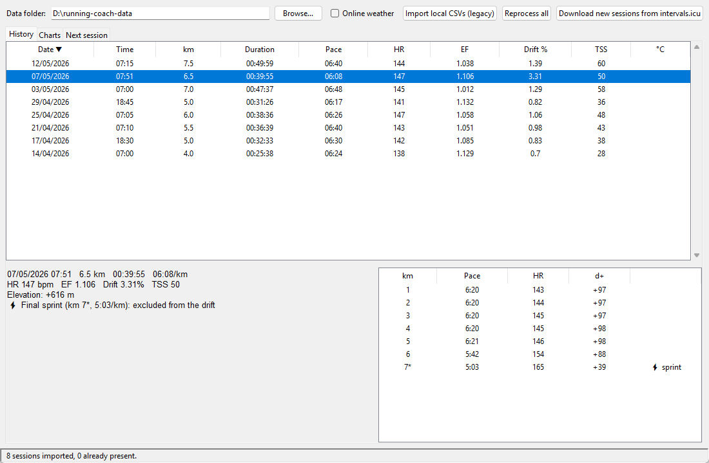
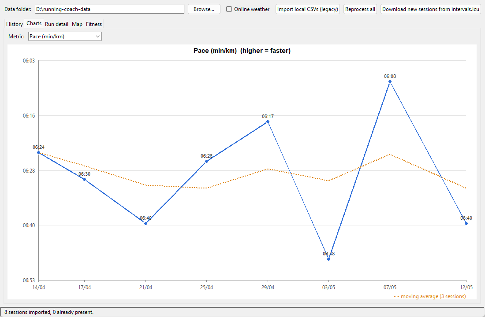
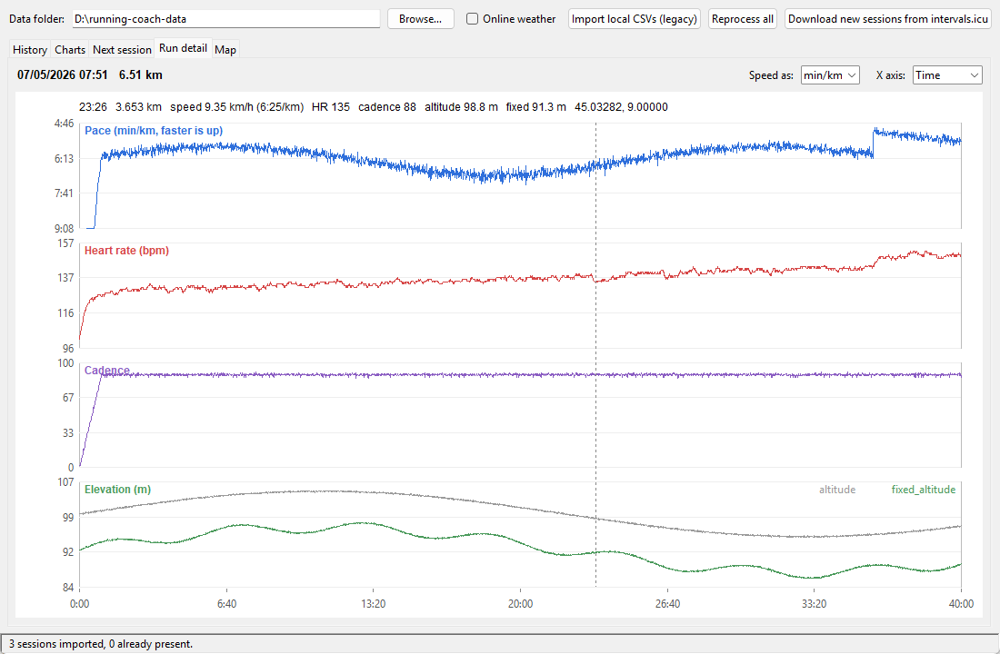
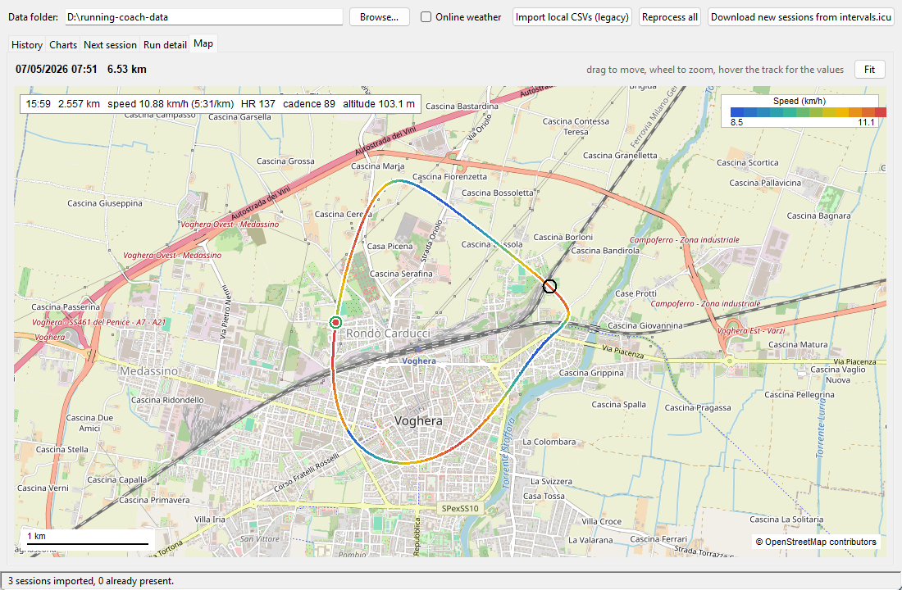
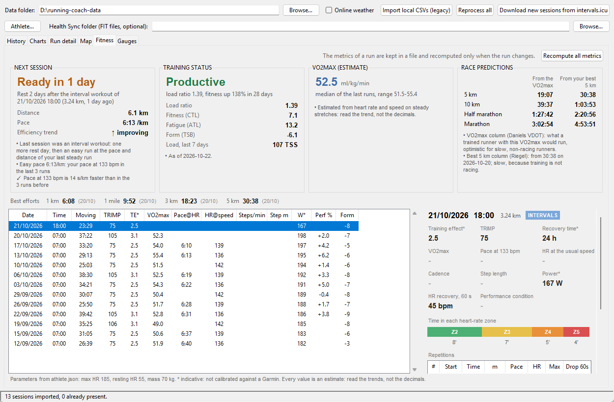

# running-coach

Command-line analyzer for running sessions exported from [intervals.icu](https://intervals.icu).
It reads the activity CSV, computes a few training-load metrics, and keeps a local history so
each new session can be compared with the previous ones.







The screenshots use synthetic runs generated by `tests/synth.py`, not real activities.

## Metrics

- **Efficiency Factor (EF)** — metres covered per heartbeat-per-minute (`distance_m / (avg_hr × minutes)`); higher means better aerobic efficiency.
- **Cardiac drift** — how much average heart rate rises from the first to the second half of the
  steady part of the run (%). The first 10 minutes (`WARMUP_S`) and an auto-detected final-km
  sprint are excluded. A high value points to fatigue, heat or dehydration.
- **TSS** — a training-stress score from duration and heart rate relative to threshold.
- **Altitude** — the `altitude` column as recorded (minimum and maximum of the run, change over each km), read as saved: no filter, no ascent total.

### Advanced metrics (estimates)

Computed by `run_metrics.py` from the per-second data and the history, in the spirit of what a Garmin watch reports. **They are estimates:
the vendors' algorithms are proprietary, so do not expect their numbers; read the trends.** Your maximum and resting heart rate and your
mass go in `athlete.json` in the data folder (defaults 190 bpm, 60 bpm, 70 kg), never in this repository.

- **Per run**: moving time; time in the five heart-rate zones (percent of the maximum, as Garmin's defaults) and the Edwards TRIMP;
  a 0-5 *aerobic training effect* and a *recovery time* (both **indicative**: the scale is mine, not calibrated against a Garmin);
  **VO2max estimate** (heart rate at a steady speed, ACSM running equation, heart-rate reserve taken as VO2 reserve: about +-10%);
  **pace at a fixed heart rate** and **heart rate at the usual speed** (the cleanest fitness trend: it does not depend on how hard you chose to run);
  steps per minute and step length (a CSV cadence below 120 is read as per foot and doubled); a **rough power model**
  (not a measured power); **performance condition** (efficiency of minutes 6-20 against your last ten runs); heart-rate recovery in 60 s
  (when the recording goes on after you stop) and heart-rate rise time at the start; second half against first half, kilometre-time variability;
  best efforts (fastest 1 km, 1 mile, 3, 5, 10 km, half marathon inside the run) and surges/intervals detected from the speed.
- **From the history**: *Fitness* (CTL, 42 days), *Fatigue* (ATL, 7 days) and *Form* (TSB) from the TSS; the acute/chronic load ratio
  (load of the last 7 days over the weekly average of the last 28, as Garmin states it); a training status label (a heuristic modelled on Garmin's:
  Productive, Maintaining, Recovery, Unproductive, Ramping up, Strained, Overreaching, Detraining); race predictions from the VO2max
  (Daniels-Gilbert VDOT) and from your best recent effort (Riegel, slow because training is not racing); all-time best efforts.
- Not possible with this data: ground contact time, vertical oscillation, HRV, Body Battery, sleep (they need other sensors).

The values are computed in a thread when the **Fitness** tab, or **Charts** on an advanced metric, is opened, and cached in
`run_metrics_cache.json` in the data folder (recomputed when a CSV, the merges or `athlete.json` change).

### Sources and how far each estimate is checked

None of the estimates is validated against a Garmin watch or a laboratory. This is what each rests on, as of October 2026.

**Sources whose text or abstract was read**

| Used for | Source | What it gives |
|---|---|---|
| VO2max from the heart rate | Swain and Leutholtz, 1997, *Medicine & Science in Sports & Exercise* 29:410-4, [doi:10.1097/00005768-199703000-00018](https://doi.org/10.1097/00005768-199703000-00018) | In 63 adults, the percentage of heart-rate reserve equals the percentage of VO2 reserve (slope 1.00, intercept -0.1), not of VO2max. Measured on a cycle ergometer, not in running. |
| Rough running power | Minetti et al., 2002, *Journal of Applied Physiology* 93:1039-46, [doi:10.1152/japplphysiol.01177.2001](https://doi.org/10.1152/japplphysiol.01177.2001) | The metabolic cost of running is 3.40 J/kg/m on the level, independent of speed, and changes with the slope. The coefficient 1.04 W per kg per m/s is 0.31 of that: the 0.31 (mechanical over metabolic) is an assumption, not a measured efficiency. |
| VO2max method and its accuracy | Firstbeat, [Automated Fitness Level (VO2max) Estimation with Heart Rate and Speed Data](https://www.firstbeat.com/en/aerobic-fitness-level-vo%e2%82%82max-estimation-firstbeat-white-paper-2/), 2014, updated 2017 | The same idea (heart rate against speed, in reliable stretches only, with the maximum heart rate). Their algorithm has an error of about 5% against the laboratory over 2690 runs, and about 7-9% if the maximum heart rate is off by 15 bpm. That accuracy does **not** transfer to the simplified version here. |
| Training effect scale | Firstbeat, [EPOC Based Training Effect Assessment](https://www.firstbeat.com/en/training-effect-firstbeat-white-paper-2/), 2005, updated 2012 | The 0-5 bands. Their value comes from the peak EPOC and the athlete's activity class of the last month; the training effect here is **not** that method (see below). |
| Load ratio bands | Garmin manual, [Training Status](https://www8.garmin.com/manuals-apac/webhelp/marqathletegen2/EN-SG/GUID-9C1771B0-C377-4A7D-B010-548D96ADB9D4-8721.html) | Load ratio: low below 0.8, optimal 0.8 to 1.4, high 1.5 to 1.9, very high 2.0 or more. The status labels are only described there, without thresholds. |

**Sources known only through secondary descriptions (the primary text was not read)**

- *Race predictions from the best effort*: Riegel, "Athletic Records and Human Endurance", *American Scientist* 69(3):285-290, 1981 ([JSTOR](https://www.jstor.org/stable/27850427)). The exponent 1.06 is the popular rounding; a reconstruction of Riegel's own regression gives about 1.077, and the formula is said to work best between 1.5 km and the marathon.
- *VO2 at a steady speed*: the ACSM running equation `0.2 x speed + 0.9 x speed x grade + 3.5` (speed in m/min), from the ACSM Guidelines for Exercise Testing and Prescription. It is described as valid above 134 m/min (8 km/h), or from 80 m/min when truly jogging. A [study of athletes](https://pubmed.ncbi.nlm.nih.gov/24376318/) found it 14.6% above the measured VO2max, but that used it to predict a maximal test, not as here.
- *Race predictions from the VO2max*: the Daniels-Gilbert VDOT equations (J. Daniels, *Daniels' Running Formula*). The constants match several online calculators and reproduce the VDOT 50 row of Daniels' table (5 km 19:56 against 19:57, 10 km 41:20 against 41:21, marathon 3:10:40 against 3:10:49).
- *TRIMP*: Edwards' zone weights 1 to 5 (S. Edwards, *The Heart Rate Monitor Book*, 1993), from memory of the book.
- *Fitness, Fatigue, Form*: the usual exponential averages of 42 and 7 days of the TSS.

**What is mine, not from a source**

- The **training effect** (`5 x (1 - exp(-TRIMP / 110))`) and the **recovery time** (`4 x TE^2` hours): only the 0-5 reading is Firstbeat's; the scale is not calibrated against a Garmin, and Firstbeat's own does not depend on the TRIMP.
- The **training status** labels (Productive, Maintaining, Recovery, Unproductive, Ramping up, Strained, Overreaching, Detraining) and their thresholds, including "Ramping up" below 100 TSS in 7 days.
- Reading the **chronic load** as the weekly average of the last 28 days (Garmin and Firstbeat define it as the load of the last 28 days).
- The **performance condition** window (minutes 6-20, against the median of the previous ten runs).

**Accuracy to expect.** On a real set of 35 easy runs the per-run VO2max estimate scatters by about +-10% between runs, so read the median of the last five and the trend. The maximum heart rate matters: Firstbeat reports 7-9% of error on the VO2max for 15 bpm of error on it, so use a measured value if you can. For slow jogging (below about 8 km/h, where the ACSM equation is at the edge of its validity) the
VO2max is less certain, and the race predictions from it are optimistic: they say what a trained runner with that VO2max would run,
not what a slow, non-racing runner will.

## GUI

```
py running-coach-gui.pyw        # or double-click the file (Windows opens it without a console)
```

Pick the data folder (the one with the `YYYY.MM.DD HH.MM-RUNNING.csv` files and `running_history.csv`;
it is remembered in `~/.running_coach_gui.json`), then:

- **Download new sessions from intervals.icu** fetches the per-second streams of the runs not yet in the folder
  (running only, saved as `YYYY.MM.DD HH.MM-RUNNING.csv`) and then imports them. It needs your intervals.icu API key
  (Settings → Developer Settings): put it in `intervals_api_key.txt` next to the program (gitignored) or in the
  `INTERVALS_API_KEY` environment variable.
- **Import local CSVs (legacy)** analyses only the CSVs already in the folder and not yet in the history (no download). **Reprocess all**
  recomputes every session (the weather already recorded is kept).
- **History** lists all sessions; select one to see the per-km splits, sprint note and weather.
- **Run detail** (double-click a run, or open the tab) plots every per-second column saved in the CSV for the selected run:
  speed (`velocity_smooth`, shown as km/h or as pace in min/km with the faster pace up), heart rate, cadence, and both `altitude` and
  `fixed_altitude`, against time or distance.
  Moving the mouse shows all the values of that second (with pace and GPS position).
- **Fitness** opens with the advice for the next session (rest days, distance, pace, from the TSS, the drift, the efficiency trend, the
  load ratio and your pace at a fixed heart rate), then the advanced metrics: a summary (load, status, VO2max, race predictions, best
  efforts) and a table with one row per run; select a row for its full list. The same metrics can be plotted over time in **Charts**.
- **Map** draws the GPS track of the selected run (start in green, end in red) over an OpenStreetMap map of the area, with a scale bar,
  coloured by speed (slow blue to fast red, between the 5th and 95th percentile of the run, with a legend). Drag to move, mouse wheel to zoom
  (the point under the cursor stays put), **Fit** to see the whole track again; hovering the track shows time, distance, speed and pace,
  heart rate, cadence and altitude at that point.
  The tiles are downloaded from `tile.openstreetmap.org` only while this tab is open and are cached in `~/.running_coach_tiles`
  (one run needs about 10-20 tiles). The requests carry tile numbers, not your track, but they do reveal the area you are looking at.
  Without a connection the track is drawn on a grey background. The example above is a synthetic loop, not a real run.
- **Merge runs / Unmerge runs** (right-click in the History table, select two or more runs first): merges runs recorded as
  one outing; nothing is deleted, the CSVs stay and *Unmerge runs* restores them. Merged sessions are highlighted.
- **Charts** plots distance, pace, heart rate, EF, drift or TSS over time with a 3-session moving average.

The program is the GUI (`pythonw running-coach-gui.pyw`); `parse_run_csv.py` holds the logic it uses and the history format.

**Weather lookup.** For each session it queries the [Open-Meteo](https://open-meteo.com) historical API with the **start
coordinates** of the activity to record temperature, humidity and wind. If the request fails the program continues without
weather data. Untick **Online weather** (or set `FETCH_WEATHER = False`) if you do not want coordinates sent to an external service.

## Outings recorded as several sessions

If a run was recorded as several sessions (the recording restarted after a pause), select them in the History table and use
the right-click menu **Merge runs**, or list them by hand in `merged_sessions.json`
in the data folder, the first one as the key: `{"2026.08.18 16.45": ["2026.08.18 17.21", "2026.08.18 17.38"]}`.
They are then analysed as one session starting at the first: distances and moving times add up (the pause is not
counted), and the member sessions disappear from the history. Their CSVs stay in the folder so a download does not
fetch them again. Run **Import local CSVs (legacy)** (or the download button) once to apply it.

## The history file

`running_history.csv` has one row per session with the columns `date` (dd/mm/yyyy), `time`, `dist_km`, `duration_hms`,
`pace_minkm`, `avg_hr_bpm`, `ef_m_beat`, `drift_pct`, `tss`, `temp_c`, `humidity_pct`, and `wind_kmh`.
The recommendations use only objective data (TSS, cardiac drift, EF trend); the former subjective "legs" rating was
removed. Files written by earlier versions (Italian column names such as `data`, `orario`, and the `gambe` / `legs`
column) are still read: the names are translated and the legs column is dropped the next time the history is saved.

## Configuration

Personal parameters are constants at the top of the script. Edit them to match your own values:

| Constant | Meaning |
|---|---|
| `THRESHOLD_HR` | Lactate-threshold heart rate (bpm) |
| `EF_BASELINE` | Baseline efficiency (m/beat) used as a reference |
| `FETCH_WEATHER` | Query Open-Meteo for weather (the *Online weather* box of the GUI overrides it) |
| `DRIFT_LOW`, `DRIFT_HIGH`, `DRIFT_VERY_HIGH` | Drift thresholds (%) for the "good" / "high" / "very high" messages and the rest-day and distance adjustments |
| `WARMUP_S` | Seconds excluded from the start when computing cardiac drift |
| `SPRINT_PACE_S`, `SPRINT_HR_BPM` | How much faster / higher than the median flags a sprint |

**Keeping data out of this repo.** Point the data folder box of the GUI (or the `RUNNING_COACH_DATA`
environment variable, read at start-up) at a separate folder: the activity CSVs are read from it and
`running_history.csv` is written to it — for example a private data-only repository cloned next to this one.

Body parameters for the advanced metrics (`hr_max`, `hr_rest`, `mass_kg`, optionally `cadence_factor` 1 or 2, `hr_ref`, and `hr_max_estimated: true` when the maximum heart rate is a formula or a guess, not measured) go in
`athlete.json` in that folder, e.g. `{"hr_max": 190, "hr_rest": 60, "mass_kg": 70}`.

## Tests

```
py -m unittest discover -s tests -v
```

`tests/synth.py` generates synthetic intervals.icu-style CSVs (doubled Samsung distance, GPS lockup
at the start, optional final-km sprint), so the logic can be checked without real data.

## Privacy

This repository contains code only. `.gitignore` excludes `*.csv`, `*.fit`, `*.tcx`, `*.gpx`
and `running_history.csv`, so activity exports, GPS tracks and your history never get committed.
Keep your own data files out of version control.

## Requirements

Python 3, standard library only (the charts are drawn on a Tkinter canvas, without matplotlib). The GUI needs Tkinter, which ships with the standard Python
installer on Windows and macOS (Linux: `sudo apt install python3-tk`).

## License

[MIT](LICENSE)
